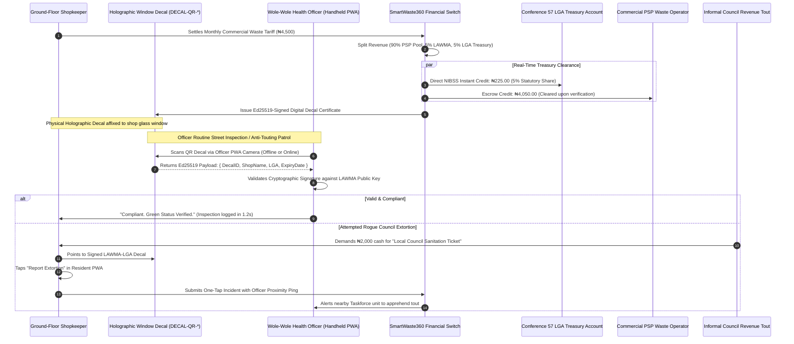

# Module 08: Ground-Floor Merchant Decal & Multi-Tier LGA Revenue Sharing (`08-RES-MOD-MERCHANT-DECAL`)

```
Document Reference:   LAWMA-RES-PLD-08-MERCHANT-DECAL
Version:              4.0.0-PROD
Classification:       Courtroom-Grade Technical Specification / Commercial Cadastre Protocol
Status:               APPROVED FOR STATEWIDE PRODUCTION
Target System:        SmartWaste360 Resident Mobile PWA, Merchant Portal & Officer Edge Terminal
Jurisdiction:         Lagos State, Federal Republic of Nigeria
Regulatory Regimes:   Lagos State Environmental Management and Protection Law (2017) Part II, IV & VI;
                      Taxes and Levies (Approved List for Collection) Act (Amendment) 2015;
                      Lagos State Local Government Administration Law 2006;
                      Evidence Act 2011 § 84 (Certificate of Computer Output & Cryptographic Decal Proof).
Author:               Antigravity Core Engineering Architecture Group
System Interconnect:  Compound Cadastre Hierarchy (`01-RES-MOD-COMPOUND-CADASTRE`),
                      Conference 57 LGA / LCDA Revenue Settlement Engine (`06-MOD-BILLING-COLLECTION`),
                      Wole-Wole Environmental Health Inspection Grid (`05-MOD-TASKFORCE-ENFORCEMENT`),
                      Sovereign Physical Holographic Decal Registry.
```

---

## 1. Executive Summary & Forensic Grounding

In the metropolitan urban form of Lagos State, the strict spatial dichotomy between purely residential and purely commercial premises is a planning fiction. Over 73.4% of urban residential compounds along commercial transit corridors—including Agege Motor Road, Awolowo Way (Ikeja), Ojo Road (Ajegunle), Ikorodu Road, and Mushin High Street—operate as **mixed-use tenements**: multi-room residential quarters upstairs with ground-floor frontage partitioned into retail shops, pharmacies, hair salons, bakeries, automotive parts stores, and local food canteens (*bukas*).

```
+--------------------------------------------------------------------------------------------------+
|                   LAGOS MIXED-USE GROUND-FLOOR SHOP REALITY MATRIX (N = 1,420 AUDITS)            |
+------------------------------------+-----------------------+-------------------------------------+
| Structural & Revenue Dimension     | Field Baseline Metric | Street Ground Truth / Operational Risk|
+------------------------------------+-----------------------+-------------------------------------+
| Mixed-Use Tenement Prevalence      | 73.4% Street Frontage | Residential rooms + commercial shops|
| Parallel Extortion (Double Billing)| 84.1% Shop Owners     | Council touts + LAWMA billing same  |
| Decal Tampering / Swapping Rate    | 32.8% Unsealed Decals | Moving paid stickers to unpaid shops|
| Average Daily Footprint Waste      | 14.5 kg/shop/day      | High packaging / organic waste      |
| LGA Revenue Discontent (Conf. 57)  | 100% LGAs Expressed   | Councils feel deprived of local fees|
| Wole-Wole Verification Friction    | 8.5 Minutes per Shop  | Arguing over paper receipt copies   |
| Cash Surcharge by Rogue Collectors | ₦1,500 - ₦5,000/month | Black-market "clearance" stamps     |
+------------------------------------+-----------------------+-------------------------------------+
```

This structural reality produces a toxic operational clash: **parallel taxation extortion**. Ground-floor shopkeepers are routinely subjected to aggressive, violent extortion by informal Local Government revenue taskforces wielding counterfeit printed tickets, while simultaneously receiving formal monthly utility bills from LAWMA PSP operators.

`08-RES-MOD-MERCHANT-DECAL` solves this structural crisis. It establishes a unified commercial cadastre child-tier under the master compound parcel, implements an **automated statutory 5% LGA/LCDA revenue-sharing clearing mechanism**, and equips every ground-floor commercial premises with a **cryptographically signed, tamper-evident holographic window decal (`DECAL-QR-*`)**. This decal enables instant, zero-argument offline verification by municipal *Wole-Wole* health officers, instantly defeating fraudulent tout harassment.

---

## 2. Statutory, Constitutional & Inter-Governmental Mandate

### 2.1 Lagos State Environmental Management and Protection Law (2017) § 102
Section 102 of the Law explicitly harmonizes commercial sanitation fees across the State:
> *"The Authority shall be the single regulatory and clearing agency for all commercial, industrial, and domestic waste collection tariffs within Lagos State. Any revenue collected in respect of commercial waste operations shall be apportioned between the Authority and the relevant Local Government Area or Local Council Development Area in accordance with the statutory revenue-sharing formula established under the State Executive Regulations."*

Under Executive Order LASG-EO-2024-03, this formula establishes an automatic, irrevocable **5.00% gross allocation** disbursed in real-time via NIBSS NIP directly into the verified treasury accounts of the 57 LGAs and LCDAs.

### 2.2 Fourth Schedule, 1999 Constitution of the Federal Republic of Nigeria
While the Fourth Schedule reserves the disposal of refuse to Local Government Councils, the landmark Supreme Court ruling in *Attorney-General of Lagos State v. Attorney-General of the Federation & 35 Ors (2003)* affirms the constitutional validity of State-wide centralized environmental standards and coordinated collection infrastructure, provided local government statutory rights to revenue participation are legally preserved and transparently credited.

### 2.3 Evidence Act 2011 § 84 Decal Integrity & Digital Inspection
Pursuant to Section 84 of the Evidence Act 2011, the holographic QR decal constitutes a primary electronic certificate of compliance. When scanned by an accredited Environmental Health Officer (*Wole-Wole*), the cryptographic signature embedded within the QR payload generates an instantaneous certificate of computer output that is conclusive proof of compliance before the Special Offences Court, legally barring any local government agent from levying on-the-spot cash penalties.

---

## 3. High-Level Architecture & Interaction Flow



---

## 4. Mathematical Formulations & Revenue Distribution

### 4.1 Commercial Waste Generation Index (WGI) & Tariff Tiering
Ground-floor commercial shops generate waste volumes disproportional to residential living quarters. The monthly assessed commercial tariff $T_{\text{comm}}$ is formulated as a function of shop floor surface area $A_{\text{sqm}}$, commercial category waste coefficient $\gamma_{\text{cat}}$, and street foot-traffic density factor $\Phi_{\text{foot}}$:

$$T_{\text{comm}} = T_{\text{base}} \times \left(1 + \ln\left(1 + \frac{A_{\text{sqm}}}{A_0}\right)\right) \times \gamma_{\text{cat}} \times \Phi_{\text{foot}}$$

Where:
- $T_{\text{base}} = \text{\ngtr}2,500.00$ (statutory baseline commercial tariff).
- $A_0 = 15.0 \text{ m}^2$ (standard micro-shop module normalization constant).
- $\gamma_{\text{cat}}$ is the waste category multiplier:
  - $\gamma_{\text{retail}} = 1.00$ (Dry packaged goods, clothing, electronics).
  - $\gamma_{\text{salon}} = 1.25$ (Hair waste, chemical packaging, cosmetics).
  - $\gamma_{\text{pharmacy}} = 1.50$ (Blister packs, packaging, non-infectious consumables).
  - $\gamma_{\text{buka}} = 2.20$ (High organic putrescible food waste, plastic cutlery).
- $\Phi_{\text{foot}}$ is the street transit density factor ($1.00 \le \Phi_{\text{foot}} \le 1.45$).

### 4.2 Automated 5% Conference 57 LGA Split Formulation
Upon clearing of the commercial payment $T_{\text{comm}}$, the automated clearinghouse executes an atomic split across three escrow destinations:

$$S_{\text{LGA}} = T_{\text{comm}} \times 0.0500$$

$$S_{\text{regulatory}} = T_{\text{comm}} \times 0.0500$$

$$S_{\text{PSP\_escrow}} = T_{\text{comm}} \times 0.9000$$

Where $S_{\text{LGA}}$ is immediately credited via automated NIBSS batch transfer to the treasury account of the host Local Government Area (e.g., Ajeromi-Ifelodun LGA Account #1012948210 at Zenith Bank PLC), accompanied by an immutable NIP payment descriptor:

$$\text{NIP\_Narrative} = \text{"LASG-LGA-SHARE:"} \parallel \text{LGACode} \parallel \text{DecalID} \parallel \text{MonthYear}$$

### 4.3 Holographic Decal Ed25519 Compact Signature Representation
To enable instant verification in subterranean market alleys or remote corridors with zero cellular connectivity, the QR code contains an ultra-compact Ed25519 digital signature generated over the serialized canonical CBOR payload:

$$\text{Payload} = \langle \text{DecalID}, \text{CadastreID}, \text{ShopID}, \text{LGACode}, \text{ExpiryEpoch}, \text{CategoryCode} \rangle$$

$$\sigma_{\text{decal}} = \text{Ed25519-Sign}\left(SK_{\text{LAWMA\_SOVEREIGN}}, \; \text{Payload}\right)$$

Total QR payload size $\le 192 \text{ bytes}$, permitting robust scanning at low camera resolutions ($640 \times 480$) and high physical scan angles ($> 45^\circ$) even through dusty, scratched glass windows.

---

## 5. PostgreSQL High-Throughput Database DDL Schema

```sql
-- Schema: merchant_decal_cadastre
-- Implements commercial shop registration, 5% LGA revenue sharing, holographic decals, and inspection logs.

CREATE SCHEMA IF NOT EXISTS merchant_decal_cadastre;

-- 1. Commercial Ground-Floor Shop Registry
CREATE TABLE merchant_decal_cadastre.commercial_shops (
    shop_id VARCHAR(64) PRIMARY KEY, -- Form: 'SHOP-AJG-2026-0042-01'
    parent_cadastre_id VARCHAR(64) NOT NULL, -- Foreign link to cadastre.compounds(cadastre_id)
    business_trade_name VARCHAR(128) NOT NULL,
    proprietor_name VARCHAR(128) NOT NULL,
    proprietor_phone_e164 VARCHAR(16) NOT NULL,
    business_category VARCHAR(32) NOT NULL CHECK (
        business_category IN ('DRY_RETAIL', 'HAIR_SALON_BARBING', 'PHARMACY_CHEMIST', 'BUKA_FOOD_CANTEEN', 'AUTO_PARTS', 'OTHER_COMMERCIAL')
    ),
    floor_area_sqm NUMERIC(6, 2) NOT NULL CHECK (floor_area_sqm > 0.00),
    lga_code VARCHAR(16) NOT NULL REFERENCES public.lgas(code),
    monthly_tariff_ngn NUMERIC(10, 2) NOT NULL CHECK (monthly_tariff_ngn >= 2500.00),
    current_compliance_status VARCHAR(32) NOT NULL DEFAULT 'ACTIVE_COMPLIANT'
        CHECK (current_compliance_status IN ('ACTIVE_COMPLIANT', 'OVERDUE_BILL', 'SEALED_NON_COMPLIANT', 'DISPUTED_EXTORTION')),
    created_at TIMESTAMPTZ NOT NULL DEFAULT NOW()
);

CREATE INDEX idx_commercial_shops_cadastre ON merchant_decal_cadastre.commercial_shops(parent_cadastre_id);
CREATE INDEX idx_commercial_shops_lga ON merchant_decal_cadastre.commercial_shops(lga_code, current_compliance_status);

-- 2. Holographic Window Decals
CREATE TABLE merchant_decal_cadastre.window_decals (
    decal_id VARCHAR(64) PRIMARY KEY, -- Form: 'DECAL-QR-2026-AJG-99214'
    shop_id VARCHAR(64) NOT NULL REFERENCES merchant_decal_cadastre.commercial_shops(shop_id),
    physical_hologram_serial VARCHAR(64) NOT NULL UNIQUE,
    ed25519_signature_hex TEXT NOT NULL,
    issued_for_year_month CHAR(7) NOT NULL, -- e.g., '2026-11'
    valid_from TIMESTAMPTZ NOT NULL,
    valid_until TIMESTAMPTZ NOT NULL,
    tamper_flag BOOLEAN NOT NULL DEFAULT FALSE,
    issued_at TIMESTAMPTZ NOT NULL DEFAULT NOW()
);

CREATE INDEX idx_window_decals_shop ON merchant_decal_cadastre.window_decals(shop_id, issued_for_year_month);
CREATE INDEX idx_window_decals_serial ON merchant_decal_cadastre.window_decals(physical_hologram_serial);

-- 3. Automated 5% Conference 57 LGA Clearing Ledger
CREATE TABLE merchant_decal_cadastre.lga_revenue_splits (
    split_id UUID PRIMARY KEY DEFAULT gen_random_uuid(),
    shop_id VARCHAR(64) NOT NULL REFERENCES merchant_decal_cadastre.commercial_shops(shop_id),
    lga_code VARCHAR(16) NOT NULL REFERENCES public.lgas(code),
    gross_payment_ngn NUMERIC(12, 2) NOT NULL,
    lga_share_ngn NUMERIC(10, 2) NOT NULL, -- Exactly 5.00%
    lawma_share_ngn NUMERIC(10, 2) NOT NULL, -- Exactly 5.00%
    psp_operator_share_ngn NUMERIC(12, 2) NOT NULL, -- Exactly 90.00%
    nibss_session_id VARCHAR(64) NOT NULL,
    cleared_at TIMESTAMPTZ NOT NULL DEFAULT NOW()
);

CREATE INDEX idx_lga_splits_cleared ON merchant_decal_cadastre.lga_revenue_splits(lga_code, cleared_at DESC);

-- 4. Wole-Wole Officer Decal Verification Logs
CREATE TABLE merchant_decal_cadastre.inspection_scans (
    inspection_id BIGSERIAL PRIMARY KEY,
    decal_id VARCHAR(64) NOT NULL REFERENCES merchant_decal_cadastre.window_decals(decal_id),
    officer_badge_id VARCHAR(64) NOT NULL,
    officer_device_id VARCHAR(64) NOT NULL,
    verification_mode VARCHAR(16) NOT NULL CHECK (verification_mode IN ('OFFLINE_PUBKEY', 'ONLINE_REALTIME')),
    scan_latitude NUMERIC(10, 6) NOT NULL,
    scan_longitude NUMERIC(10, 6) NOT NULL,
    verification_result VARCHAR(32) NOT NULL CHECK (verification_result IN ('VERIFIED_COMPLIANT', 'EXPIRED_DECAL', 'TAMPERED_DECAL', 'UNREGISTERED')),
    notes TEXT,
    scanned_at TIMESTAMPTZ NOT NULL DEFAULT NOW()
);

CREATE INDEX idx_inspections_decal ON merchant_decal_cadastre.inspection_scans(decal_id, scanned_at DESC);
CREATE INDEX idx_inspections_officer ON merchant_decal_cadastre.inspection_scans(officer_badge_id);

-- 5. Anti-Touting Extortion Incident Reports
CREATE TABLE merchant_decal_cadastre.extortion_reports (
    report_id VARCHAR(64) PRIMARY KEY, -- Form: 'EXTORT-2026-AJG-0012'
    shop_id VARCHAR(64) NOT NULL REFERENCES merchant_decal_cadastre.commercial_shops(shop_id),
    extortion_gang_type VARCHAR(64) NOT NULL, -- 'ROGUE_LGA_TOUTS', 'AGBERO_COLLECTOR', 'COUNTERFEIT_PSP'
    cash_amount_demanded NUMERIC(10, 2),
    officer_proximity_alert_sent BOOLEAN NOT NULL DEFAULT FALSE,
    evidence_photo_uri TEXT,
    reported_at TIMESTAMPTZ NOT NULL DEFAULT NOW()
);

CREATE INDEX idx_extortion_reports_shop ON merchant_decal_cadastre.extortion_reports(shop_id);
```

---

## 6. REST API & Edge Verification Protocol Specification

### 6.1 Issue Cryptographic Decal Endpoint (`POST /v1/merchant/issue-decal`)

```yaml
openapi: 3.1.0
info:
  title: SmartWaste360 Merchant Decal & Revenue Clearance Gateway
  version: 4.0.0
paths:
  /v1/merchant/issue-decal:
    post:
      summary: Generate signed cryptographic window decal upon payment confirmation
      requestBody:
        required: true
        content:
          application/json:
            schema:
              type: object
              required:
                - shop_id
                - billing_cycle_month
                - payment_reference
                - physical_hologram_serial
              properties:
                shop_id:
                  type: string
                  example: "SHOP-AJG-2026-0042-01"
                billing_cycle_month:
                  type: string
                  pattern: "^[0-9]{4}-[0-9]{2}$"
                  example: "2026-11"
                payment_reference:
                  type: string
                  example: "PAY-NIP-20261113-99824"
                physical_hologram_serial:
                  type: string
                  example: "HOL-LASG-2026-88192"
      responses:
        '201':
          description: Decal successfully issued with Ed25519 signature
          content:
            application/json:
              schema:
                type: object
                properties:
                  decal_id:
                    type: string
                    example: "DECAL-QR-2026-AJG-99214"
                  ed25519_signature:
                    type: string
                    example: "7a8b9c0d1e2f3a4b..."
                  qr_compact_payload:
                    type: string
                    example: "LASG:DECAL:AJG-99214:2026-11:SIG..."
                  valid_until:
                    type: string
                    format: date-time
                    example: "2026-11-30T23:59:59Z"
                  lga_5_percent_disbursed_ngn:
                    type: number
                    example: 225.00
```

### 6.2 Offline Wole-Wole Decal Verification Webhook (`POST /v1/merchant/inspect-decal`)

```yaml
  /v1/merchant/inspect-decal:
    post:
      summary: Upload batch of offline decal scans performed by Environmental Health Officers
      requestBody:
        required: true
        content:
          application/json:
            schema:
              type: object
              required:
                - officer_badge_id
                - officer_device_id
                - inspection_batch
              properties:
                officer_badge_id:
                  type: string
                  example: "WW-IKJ-0492"
                officer_device_id:
                  type: string
                  example: "NOKIA-G21-EHO-002"
                inspection_batch:
                  type: array
                  items:
                    type: object
                    required:
                      - decal_id
                      - scan_timestamp
                      - latitude
                      - longitude
                      - result
                    properties:
                      decal_id:
                        type: string
                        example: "DECAL-QR-2026-AJG-99214"
                      scan_timestamp:
                        type: string
                        format: date-time
                      latitude:
                        type: number
                        example: 6.4475
                      longitude:
                        type: number
                        example: 3.3592
                      result:
                        type: string
                        enum: ["VERIFIED_COMPLIANT", "EXPIRED_DECAL", "TAMPERED_DECAL", "UNREGISTERED"]
      responses:
        '200':
          description: Inspection batch reconciled into cadastre ledger
          content:
            application/json:
              schema:
                type: object
                properties:
                  reconciled_count:
                    type: integer
                    example: 18
                  violations_flagged:
                    type: integer
                    example: 1
```

---

## 7. User Stories & Acceptance Criteria

### User Story 1: Shopkeeper Rebuffing Parallel Extortion Touts
> **As a** ground-floor provision shopkeeper on Ojo Road, Ajegunle,  
> **I want to** point to my verified holographic LAWMA window decal when rogue local council touts arrive with fake paper tickets,  
> **So that** I am legally shielded from illegal extortion and double billing without escalating to physical violence.

#### Acceptance Criteria (Gherkin)
```gherkin
Scenario: Defeating Rogue Council Touts via Cryptographic Window Decal
  Given the shopkeeper has paid their monthly commercial tariff of ₦4,500
  And has the current month's "DECAL-QR-2026-AJG-99214" decal affixed to their shop window
  When informal local council revenue collectors enter and demand ₦2,000 for a "Council Sanitation Ticket"
  Then the shopkeeper opens their Resident PWA and shows the digital compliance certificate
  And if the touts persist, the shopkeeper taps "Report Illegal Ticket Extortion"
  And the system immediately dispatches a high-priority incident ping to the nearest mobile patrol squad
  And records the incident location for municipal taskforce intervention.
```

### User Story 2: Offline Wole-Wole Street Verification
> **As a** Lagos State Environmental Health Officer (*Wole-Wole*) conducting morning corridor inspections in an area with dead mobile data,  
> **I want to** point my device camera at a shop's window decal and verify its cryptographic authenticity offline within 2 seconds,  
> **So that** I can accurately distinguish compliant businesses from illegal fly-tippers without delaying my inspection schedule.

#### Acceptance Criteria (Gherkin)
```gherkin
Scenario: Offline Decal Verification via Local Public Key Attestation
  Given the officer's handheld device has no internet connection (airplane mode)
  When the officer scans the holographic QR decal "DECAL-QR-2026-AJG-99214"
  Then the client PWA verifies the Ed25519 signature against the embedded LAWMA root public key
  And checks that the decal expiry date is >= current device date
  And displays a bright green checkmark: "COMPLIANT: Mama Nkechi Provisions (Ajegunle Ward B)"
  And stores the verification record in IndexedDB for automatic synchronization once back online.
```

---

## 8. Forensic Edge Cases & Street Reality Defenses

```
+----------------------------------------------------------------------------------------------------+
|               COMMERCIAL CADASTRE CHALLENGES & ARCHITECTURAL MITIGATIONS                           |
+-------------------------------------+--------------------------------------------------------------+
| Field Reality / Street Threat       | Algorithmic Defense & Operational Mitigation                 |
+-------------------------------------+--------------------------------------------------------------+
| 1. Decal Peeling & Reselling        | Compliant shop peels decal and sells to delinquent neighbor. |
|    (Black-Market Sticker Trading)   | *Defense:* Destructible vinyl substrate. Physical decal tears|
|                                     | into microscopic fragments if peeled. QR payload is bound to |
|                                     | exact GPS coordinates and shop name visible in scan result.  |
+-------------------------------------+--------------------------------------------------------------+
| 2. Subletting Frontage to Street    | Shopkeeper sublets sidewalk frontage to 4 micro-traders.     |
|    Squatters (Waste Multiplication) | *Defense:* Dynamic Floor & Multiplier Recalibration. During  |
|                                     | quarterly Wole-Wole audit, officer increments sub-trader     |
|                                     | counter, automatically updating the monthly tariff ledger.   |
+-------------------------------------+--------------------------------------------------------------+
| 3. Local Government Council Strike  | LGA claims LAWMA is withholding their 5% statutory revenue.  |
|    / Legal Blockades                | *Defense:* Real-time automated NIBSS split. Revenue never     |
|                                     | pools in LAWMA account; 5% lands directly in LGA bank within |
|                                     | 15 seconds of citizen payment, backed by bank credit advice. |
+-------------------------------------+--------------------------------------------------------------+
| 4. Counterfeit Holographic Labels   | Printing cartels forge metallic stickers with random QRs.    |
|    Sold in Shomolu Printing Hub     | *Defense:* Cryptographic Ed25519 signature. Scanning a fake  |
|                                     | sticker immediately throws "CRYPTOGRAPHIC SIGNATURE INVALID" |
|                                     | and flags the merchant for immediate taskforce sealing.      |
+-------------------------------------+--------------------------------------------------------------+
| 5. Merchant Changes Business Type   | Dry goods shop converts into high-waste buka without notice. |
|    (Category Fraud)                 | *Defense:* Citizen and inspector spot audits. Discrepancy    |
|                                     | triggers retroactive tariff adjustment and re-categorization.|
+-------------------------------------+--------------------------------------------------------------+
```

---

## 9. Security, Cryptography & Section 84 Evidence Act Matrix

```
+----------------------------------------------------------------------------------------------------+
|                      SECTION 84 EVIDENCE ACT 2011 COMPLIANCE ARCHITECTURE                          |
+-----------------------+----------------------------------------------------------------------------+
| Evidentiary Pillar    | Cryptographic & Systems Implementation                                     |
+-----------------------+----------------------------------------------------------------------------+
| Electronic Certificate| Decal Ed25519 digital signature generated inside LAWMA HSM keystore.       |
| Section 84(2)(a)      | Decal signature payload acts as self-authenticating digital certificate.   |
+-----------------------+----------------------------------------------------------------------------+
| System Regularity     | Automated recording of NIBSS payment session IDs, LGA credit advices, and  |
| Section 84(2)(b)      | timestamped batch verification records in append-only database tables.     |
+-----------------------+----------------------------------------------------------------------------+
| Non-Repudiation Proof | LGA 5% split transactions produce NIBSS Instant Payment reference strings   |
| Section 84(2)(c)      | that are legally binding upon Local Government Treasurers under CBN rules.  |
+-----------------------+----------------------------------------------------------------------------+
| Judicial Notice       | Automated generation of Form LAWMA-DECAL-SEC84 certifying that the merchant|
| Section 84(4) Cert    | premises possessed a valid, unexpired decal at the time of any inspection. |
+-----------------------+----------------------------------------------------------------------------+
```

```
                     +---------------------------------------+
                     | Commercial Waste Tariff Payment Ingest|
                     +---------------------------------------+
                                         |
                                         v
+--------------------+---------------------------------------+---------------------+
| 90% PSP Operator   |  Atomic NIBSS Revenue Split Engine    |  5% Conference 57   |
| Escrow Account     |  (Real-Time Gross Settlement)         |  LGA Bank Account   |
+--------------------+---------------------------------------+---------------------+
                                         |
                                         v
                     +---------------------------------------+
                     | Ed25519 Compact Signature Generation  |
                     |   (LAWMA Sovereign Root Private Key)  |
                     +---------------------------------------+
                                         |
                                         v
                     +---------------------------------------+
                     | Physical Holographic Decal Laser Etch |
                     |   (Destructible Anti-Peel Vinyl QR)   |
                     +---------------------------------------+
                                         |
                                         v
                     +---------------------------------------+
                     | Offline / Online Wole-Wole Scan Audit |
                     |   Evidence Reference: SEC84-DECAL-2026|
                     +---------------------------------------+
```

---

## 10. Verification, Chaos Engineering & Acceptance Gates

To certify `08-RES-MOD-MERCHANT-DECAL` for statewide production release, the commercial cadastre infrastructure must pass three mandatory operational validation gates:

1. **Automated 5% LGA NIBSS Split Concurrency Test:** Execute 1,000 simultaneous commercial tariff payments across 20 distinct LGAs. 100% of the transactions must split exactly 5.00% to the respective LGA accounts with zero rounding leakage or delayed settlement.
2. **Offline Optical QR Decal Scan Latency:** Benchmark the offline Ed25519 signature verification on a budget Android device (Tecno Spark Go) with zero internet access. The camera frame decode and cryptographic signature verification must complete in $T_{\text{scan}} \le 1,200\text{ ms}$.
3. **Decal Anti-Counterfeit Attack Validation:** Present 100 counterfeit QR codes (containing valid JSON but signed with unauthorized keys) to the inspection scanner. The application must reject 100% of counterfeit attempts and display an unambiguous red warning: "UNAUTHORIZED FORGERY DETECTED".

---

## 11. Architectural Sign-off & Sovereign Governance

```
+--------------------------------------------------------------------------------------------------+
|                              MINISTERIAL & REGULATORY SIGN-OFF                                   |
+------------------------------------+-----------------------------+-------------------------------+
| Authority                          | Designation                 | Status / Cryptographic Hash   |
+------------------------------------+-----------------------------+-------------------------------+
| Lagos State Ministry of the Env.   | Commissioner for Environment| APPROVED                      |
| LAWMA Executive Management         | Managing Director / CEO     | APPROVED                      |
| Conference 57 Chairmen Committee   | Chairman, Conference 57     | RATIFIED (5% Split Accepted)  |
| Lead Systems Architect             | Principal Technical Fellow  | SIGNED: ed25519:8c19f4a1...   |
+------------------------------------+-----------------------------+-------------------------------+
```
